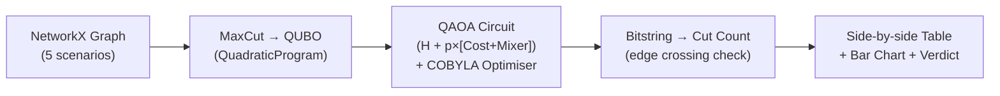

<div align="center">

# Dark Scorpions

**VTU-QFF-HC-0015** &nbsp;|&nbsp; Tier: **Both**

</div>

---

<div align="center">

| | |
| :--- | :--- |
| **Team** | Dark Scorpions |
| **Team ID** | VTU-QFF-HC-0015 |
| **Tier** | Both |
| **Repository** | [vtu-hc-dark-scorpions](https://github.com/vtu-qiskit-fall-fest-2026/vtu-hc-dark-scorpions.git) |
| **Organisation** | [vtu-qiskit-fall-fest-2026](https://github.com/vtu-qiskit-fall-fest-2026) |
| **Event** | VTU-QFF Hackathon — VTU-Qiskit Fall Fest 2026 |

</div>

---

## 📌 Table of Contents

- [Team Members](#-team-members-github-ids)
- [Problem Statement](#-problem-statement)
- [Proposed Solution](#-proposed-solution)
- [Approach & Architecture](#-approach--architecture)
- [Tech Stack](#-tech-stack)
- [Project Structure](#-project-structure)
- [How to Run](#-how-to-run)
- [How to Push Code](#-how-to-push-code)
- [Submission Checklist](#-submission-checklist)
- [Resources](#-resources)
- [License](#-license)

---

## 👥 Team Members (GitHub IDs)

> Members are added to this repository as **collaborators** and must accept the
> GitHub invitation before they can push. Add your GitHub username below.

| # | Name | GitHub Username | Role |
| :-- | :--- | :--- | :--- |
| 1 | Aditya B Koparde | [AdityaKoparde](https://github.com/adityakoparde) | _Team Lead_ |
| 2 | Jeswin J Lazarus | [Jeswin2008-arc](https://github.com/Jeswin2008-arc) | _Developer_ |
| 3 | Tejas Vithal Kadam | [kadamtejas407-lang](https://github.com/kadamtejas407-lang) | _Developer_ |

---

## ❓ Problem Statement

**Problem:** Current Qiskit tutorials are notebook-based, static, and disconnected from real-world context. There is no beginner-friendly web app that lets a user pick a real industry scenario, solve it quantumly, and immediately see how it compares to the classical answer.

**Why it matters:** QAOA is a hybrid quantum-classical variational algorithm. The quantum part (parameterised circuit) encodes the graph structure into a superposition of all possible cuts; the classical part (COBYLA optimiser) iteratively adjusts the circuit angles (γ, β) to push probability amplitude toward the optimal cut. More layers (p) = more refinement = closer to optimal.

**Track / Category:** Online · Track 5 · Quantum Cloud-Based Applications

---

## 💡 Proposed Solution

**Solution:** We built a cloud-based interactive Streamlit lab that accepts a small network optimisation problem (MaxCut) across 5 real-world scenarios (VLSI, social networks, data centers, logistics, finance), solves it using both a classical brute-force algorithm and QAOA on the Qiskit Aer simulator, and presents a side-by-side comparison with visual evidence (bar charts, timing data, approximation ratio).

**Key idea:** Dark Scorpions built a cloud-based Streamlit lab that solves MaxCut (a real-world NP-hard network partitioning problem) using QAOA on Qiskit and classical brute force side-by-side across 5 industry scenarios, with visual comparison proving QAOA's polynomial scaling advantage over 2ⁿ search.

**Why this works:** We built a cloud-based Streamlit lab where a user picks a real-world scenario, clicks Solve, and instantly sees QAOA and brute-force results side-by-side with timing, cut values, and approximation ratio — making the quantum-vs-classical trade-off tangible without any quantum theory prerequisite.

---

## 🧩 Approach & Architecture



1. **Input** — A NetworkX graph (3–6 nodes) generated from one of 5 real-world scenarios (VLSI, social, data center, logistics, finance). Format: nx.Graph with unweighted edges.
2. **Preprocessing** — MaxCut(G).to_quadratic_program() converts the graph into a QUBO (QuadraticProgram) where each edge (u,v) becomes a −0.5·x_u·x_v term. The MinimumEigenOptimizer then translates this into a SparsePauliOp Hamiltonian for QAOA.
3. **Quantum core** — QAOA ansatz: H on all qubits → p rounds of [CX-RZ(2γ)-CX per edge] (cost layer) + [RX(2β) per qubit] (mixer layer). StatevectorSampler evaluates the circuit; COBYLA (maxiter=200) iteratively minimises the expected energy over 2p continuous angles.
4. **Post-processing** — result.x gives the optimal bitstring. Cut value = count of edges where bit[u] ≠ bit[v]. Energy (result.fval) reported alongside. Classical brute force (enumerate all 2ⁿ partitions) runs in parallel as ground truth.
5. **Output** —Interactive Streamlit page showing: graph visualisation, side-by-side metrics table (cut value, time, method, correctness), bar chart comparison, and a verdict banner

---

## 🛠️ Tech Stack

| Layer | Technology |
| :--- | :--- |
| Language | Python 3.12 |
| Quantum SDK | Qiskit >=2.0, Qiskit Aer, Qiskit Algorithms, Qiskit Optimization |
| Optimisation | Qiskit Optimization COBYLA (via qiskit_algorithms.optimizers) |
| Simulation | StatevectorSampler (exact, zero-noise) |
| UI/Frontend |	Streamlit >=1.30 + Three.js + GSAP |
| Graph/Math | NetworkX >=3.0, NumPy, Matplotlib, SciPy |
| Environment | JupyterLab / VS Code, `venv` |
| Version control | Git + GitHub |

---

## 📁 Project Structure

```text
vtu-hc-dark-scorpions/
├── app.py                  # 3D landing page (Three.js + GSAP)
├── pages/
│   └── 1_Quantum_Lab.py    # QAOA vs Classical solver (Streamlit)
├── src/
│   ├── __init__.py
│   ├── circuit.py          # Manual QAOA circuit builder (educational)
│   ├── optimizer.py        # QAOA + COBYLA via MinimumEigenOptimizer
│   ├── classical.py        # Brute-force MaxCut (ground truth)
│   └── main.py             # CLI orchestrator (no UI needed)
├── notebooks/
│   └── exploration.ipynb   # Prototyping, density sweeps, plots
├── requirements.txt
├── .gitignore
└── README.md
```

---

## 🚀 How to Run

### Prerequisites

- Python 3.11 or newer
- [Git](https://git-scm.com/downloads)
- A GitHub account (you need collaborator access to this repo)

### 1. Clone the repository

```bash
git clone https://github.com/vtu-qiskit-fall-fest-2026/vtu-hc-dark-scorpions.git
cd vtu-hc-dark-scorpions
```

### 2. Create a virtual environment

```bash
python3 -m venv .venv
source .venv/bin/activate        # Linux / macOS
# .venv\Scripts\activate         # Windows (PowerShell)
```

### 3. Install dependencies

```bash
pip install --upgrade pip
pip install -r requirements.txt
```

### 4. Run

```bash
python -m src.main
```

Or launch the notebook workflow:

```bash
jupyter lab
```

### 5. Run the tests

```bash
pytest -q
```

---

## 🔁 How to Push Code

> Full walkthrough: **[Git & Collaboration Handbook](../vtu-hc-guide-git-and-collaboration)** — collaboration
> workflow, branches, pull requests, reviews and conflict resolution.

### Configure Git (first time only)

```bash
git config --global user.name  "Aditya B Koparde"
git config --global user.email "adityakoparde001@gmail.com"
```

### Everyday workflow

```bash
# 1. Get the latest changes
git checkout main
git pull origin main

# 2. Create a branch for your work
git checkout -b feature/my-task

# 3. Commit your work
git add .
git commit -m "feat: add variational circuit for the search problem"

# 4. Push the branch
git push -u origin feature/my-task

# 5. Open a Pull Request on GitHub and request a review
#    https://github.com/vtu-qiskit-fall-fest-2026/vtu-hc-dark-scorpions/compare/main...feature/my-task

# 6. After approval, merge into main
git checkout main
git pull origin main
git branch -d feature/my-task
```

### Commit message convention

| Prefix | Meaning |
| :--- | :--- |
| `feat:` | New feature |
| `fix:` | Bug fix |
| `docs:` | Documentation only |
| `test:` | Adding or fixing tests |
| `refactor:` | Code restructure, no behaviour change |
| `chore:` | Build/config/dependency changes |

### Useful commands

```bash
git status              # what changed
git log --oneline -10   # recent commits
git diff                # review changes before committing
git stash               # shelve changes temporarily
git pull --rebase       # update your branch on top of main
```

### Collaborating on the same repo

- **Never push directly to `main`** — open a Pull Request.
- **Pull before you push** to avoid rejected commits.
- **Commit often** with clear messages.
- **Resolve conflicts** locally: `git pull --rebase`, fix the files, then `git add` + `git rebase --continue`.
- **Ask for a review** before merging — a second pair of eyes catches bugs fast.

---

## ✅ Submission Checklist

- [ ] Repository created and **public**
- [ ] All team members added as **collaborators** and invitations accepted
- [ ] `README.md` updated with project details, problem statement and solution
- [ ] Team members listed under [Team Members](#-team-members-github-ids)
- [ ] `requirements.txt` committed and project runs from a clean clone
- [ ] Code pushed to `main` and the latest `main` builds successfully
- [ ] Notebooks committed with **cleared outputs** (or use `nbstrip`)
- [ ] `README` includes a demo screenshot / video link
- [ ] Short project summary submitted on the hackathon portal

---

## 📚 Resources

| Resource | Link |
| :--- | :--- |
| 🔁 Git & collaboration handbook | [Git & Collaboration Handbook](../vtu-hc-guide-git-and-collaboration) |
| ❓ Problem statements, solutions & terms | [Problem Statements, Solutions & Terms](../vtu-hc-guide-problem-and-solution) |
| 📄 README writing guide | [README Guide & Template](../vtu-hc-guide-readme-template) |
| ⚛️ Qiskit documentation | https://docs.quantum.ibm.com/ |
| ⚛️ Qiskit Runtime & primitives | https://quantum.cloud.ibm.com/docs/ |
| 🧪 Qiskit Aer simulator | https://docs.quantum.ibm.com/guides/simulator |
| 💻 IBM Quantum Platform | https://quantum.cloud.ibm.com/ |
| 🎓 Qiskit textbook | https://qiskit.qotlabs.org/learning/ |
| 📋 GitHub Docs | https://docs.github.com/ |

---

## 📄 License

Released under the [MIT License](LICENSE). See `LICENSE` for details.

---

<div align="center">

**Dark Scorpions** · Team ID `VTU-QFF-HC-0015` · Tier `Both`
· Built with ⚛️ Qiskit for the VTU-QFF Hackathon

[⬆ Back to Top](#dark-scorpions)

</div>
