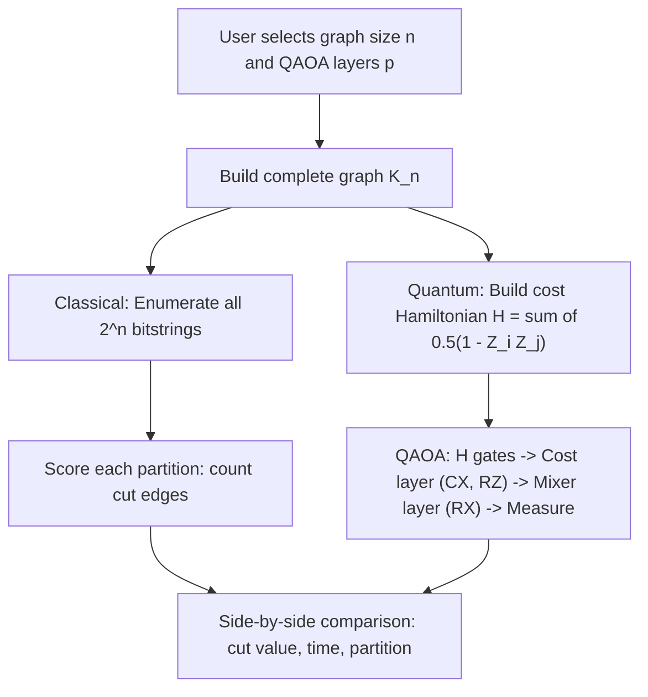

<div align="center">

# Dark Scorpions

**VTU-QFF-HC-0015** &nbsp;|&nbsp; Tier: **Both**

</div>

---

<div align="center">

| | |
| :--- | :--- |
| **Team** | Dark Scorpions |
| **Team ID** | VTU-QFF-HC-0015 |
| **Tier** | Both |
| **Repository** | [vtu-hc-dark-scorpions](https://github.com/vtu-qiskit-fall-fest-2026/vtu-hc-dark-scorpions.git) |
| **Organisation** | [vtu-qiskit-fall-fest-2026](https://github.com/vtu-qiskit-fall-fest-2026) |
| **Event** | VTU-QFF Hackathon — VTU-Qiskit Fall Fest 2026 |

</div>

---

## 📌 Table of Contents

- [Team Members](#-team-members-github-ids)
- [Problem Statement](#-problem-statement)
- [Proposed Solution](#-proposed-solution)
- [Approach & Architecture](#-approach--architecture)
- [Tech Stack](#-tech-stack)
- [Project Structure](#-project-structure)
- [How to Run](#-how-to-run)
- [How to Push Code](#-how-to-push-code)
- [Submission Checklist](#-submission-checklist)
- [Resources](#-resources)
- [License](#-license)

---

## 👥 Team Members (GitHub IDs)

> Members are added to this repository as **collaborators** and must accept the
> GitHub invitation before they can push. Add your GitHub username below.

| # | Name | GitHub Username | Role |
| :-- | :--- | :--- | :--- |
| 1 |Aditya B Koparde | [Aditya B Koparde](https://github.com/AdityaKoparde) | _Team Lead_ |
| 2 | Jeswin J Lazarus | [Jeswin J Lazarus_](https://github.com/Jeswin2008-arc) | _Developer_ |
| 3 | Tejas Vithal Kadam | [Tejas Vithal Kadam](https://github.com/kadamtejas407-lang) | _Developer_ |

---

## ❓ Problem Statement

**Problem:** Students and small research teams lack an accessible, beginner-friendly way to test small optimisation problems using quantum computing, compare the results with classical algorithms, and understand the trade-offs in solution quality, execution time, and hardware noise. Most QAOA tutorials assume prior knowledge of Hamiltonians, variational circuits, and optimisation theory — leaving newcomers with no intuitive, interactive way to see when quantum offers an advantage.

**Why it matters:** Quantum computing is often presented as a black box — "it's faster, trust us." Without a hands-on comparison tool, students can't build genuine intuition about where quantum algorithms shine and where classical methods still win. This gap slows down adoption in academic settings and makes it harder for new researchers to decide whether quantum approaches are worth pursuing for their specific problem size. An interactive lab that shows both answers side-by-side in seconds bridges that gap.

**Track / Category:** Online · Track 5 · Quantum Cloud-Based Applications

---

## 💡 Proposed Solution

<!--
Describe your solution. Keep it concrete: the core idea, the user flow, and
the quantum/ML technique you are applying.
-->

**Solution:** We built a cloud-based interactive Streamlit web application that accepts a small network graph (2–8 nodes), solves the MaxCut optimisation problem using both a classical brute-force algorithm and the Quantum Approximate Optimization Algorithm (QAOA) via Qiskit, and presents a side-by-side comparison of solution quality, execution time, and method details with visual evidence (bar charts, timing metrics, and partition visualisations).

**Key idea:** Encode MaxCut as a cost Hamiltonian (sum of Z⊗Z terms over edges), run QAOA with a tunable number of layers (p) on the Qiskit Aer simulator, and directly compare the resulting cut value and wall-clock time against exhaustive classical search — giving users an instant, visual understanding of the quantum-vs-classical trade-off at different problem sizes.

**Why this works:** By letting the user control graph size and QAOA layers interactively, the app makes the exponential growth of classical brute force (2ⁿ trials) tangible against QAOA's polynomial scaling. The side-by-side output removes the "black box" perception — students see exactly when quantum matches classical accuracy, when it falls short (sub-optimal convergence at low p), and how execution time shifts as the problem grows. This turns a 40-page textbook explanation into a 10-second click.

---

## 🧩 Approach & Architecture

<!--
Walk through how it works. A simple pipeline diagram in text or Mermaid is ideal.
-->



1. **Input** — User selects number of nodes (2–8) and QAOA layers p (1–5) via Streamlit sliders. The app constructs a complete graph Kₙ using NetworkX.
2. **Preprocessing** — The graph's edge list is extracted. For the quantum path, a cost Hamiltonian is built as a SparsePauliOp: one +0.5·Z_i·Z_j term per edge. For the classical path, all 2ⁿ bitmasks are generated.
3. **Quantum core** — QAOA circuit with p layers: (a) Hadamard initialization on all qubits, (b) cost unitary: CNOT → RZ(2γ) → CNOT per edge, (c) mixer unitary: RX(2β) per qubit. A classical COBYLA optimizer tunes angles (γ, β) to minimize expected energy. Runs on StatevectorSampler (Qiskit Aer).
4. **Post-processing** — The eigenstate with highest probability is extracted as the optimal bitstring. Energy is converted back to cut value: cut = n_edges/2 − energy. Classical path simply picks the bitmask with maximum cut count. Both are timed with time.time().
5. **Output** — A side-by-side comparison showing: best cut value, node partition, wall-clock time, and method details (trials vs layers). A bar chart visualises the cut values. A verdict message confirms whether both methods agree.
---

## 🛠️ Tech Stack

| Layer | Technology |
| :--- | :--- |
| Language | Python 3.12 |
| Quantum SDK | Qiskit ≥1.0, Qiskit Aer, Qiskit Algorithms |
| Optimisation | COBYLA (via qiskit_algorithms.optimizers) |
| Simulation | StatevectorSampler (Qiskit Aer, statevector mode) |
| Web Framework |	Streamlit |
| Graph Library |	NetworkX |
| Environment | JupyterLab / VS Code, `venv` |
| Version control | Git + GitHub |

---

## 📁 Project Structure

```text
vtu-hc-dark-scorpions/
├── README.md              # This file
├── requirements.txt       # Python dependencies
├── pyproject.toml         # Project metadata (optional)
├── .gitignore
├── notebooks/             # Jupyter notebooks for experiments
│   └── exploration.ipynb
├── src/
│   ├── __init__.py
│   ├── circuit.py         # Quantum circuit construction
│   ├── optimizer.py       # Optimization loop
│   └── main.py            # Entry point
├── data/                  # Datasets (use Git LFS for large files)
├── tests/                 # Unit tests
│   └── test_circuit.py
└── docs/                  # Notes, diagrams, reports
```

---

## 🚀 How to Run

### Prerequisites

- Python 3.11 or newer
- [Git](https://git-scm.com/downloads)
- A GitHub account (you need collaborator access to this repo)

### 1. Clone the repository

```bash
git clone https://github.com/vtu-qiskit-fall-fest-2026/vtu-hc-dark-scorpions.git
cd vtu-hc-dark-scorpions
```

### 2. Create a virtual environment

```bash
python3 -m venv .venv
source .venv/bin/activate        # Linux / macOS
# .venv\Scripts\activate         # Windows (PowerShell)
```

### 3. Install dependencies

```bash
pip install --upgrade pip
pip install -r requirements.txt
```

### 4. Run

```bash
python -m src.main
```

Or launch the notebook workflow:

```bash
jupyter lab
```

### 5. Run the tests

```bash
pytest -q
```

---

## 🔁 How to Push Code

> Full walkthrough: **[Git & Collaboration Handbook](../vtu-hc-guide-git-and-collaboration)** — collaboration
> workflow, branches, pull requests, reviews and conflict resolution.

### Configure Git (first time only)

```bash
git config --global user.name  "AdityaKoparde"
git config --global user.email "adityakoparde001@gmail.com"
```

### Everyday workflow

```bash
# 1. Get the latest changes
git checkout main
git pull origin main

# 2. Create a branch for your work
git checkout -b feature/my-task

# 3. Commit your work
git add .
git commit -m "feat: add variational circuit for the search problem"

# 4. Push the branch
git push -u origin feature/my-task

# 5. Open a Pull Request on GitHub and request a review
#    https://github.com/vtu-qiskit-fall-fest-2026/vtu-hc-dark-scorpions/compare/main...feature/my-task

# 6. After approval, merge into main
git checkout main
git pull origin main
git branch -d feature/my-task
```

### Commit message convention

| Prefix | Meaning |
| :--- | :--- |
| `feat:` | New feature |
| `fix:` | Bug fix |
| `docs:` | Documentation only |
| `test:` | Adding or fixing tests |
| `refactor:` | Code restructure, no behaviour change |
| `chore:` | Build/config/dependency changes |

### Useful commands

```bash
git status              # what changed
git log --oneline -10   # recent commits
git diff                # review changes before committing
git stash               # shelve changes temporarily
git pull --rebase       # update your branch on top of main
```

### Collaborating on the same repo

- **Never push directly to `main`** — open a Pull Request.
- **Pull before you push** to avoid rejected commits.
- **Commit often** with clear messages.
- **Resolve conflicts** locally: `git pull --rebase`, fix the files, then `git add` + `git rebase --continue`.
- **Ask for a review** before merging — a second pair of eyes catches bugs fast.

---

## ✅ Submission Checklist

- [ ] Repository created and **public**
- [ ] All team members added as **collaborators** and invitations accepted
- [ ] `README.md` updated with project details, problem statement and solution
- [ ] Team members listed under [Team Members](#-team-members-github-ids)
- [ ] `requirements.txt` committed and project runs from a clean clone
- [ ] Code pushed to `main` and the latest `main` builds successfully
- [ ] Notebooks committed with **cleared outputs** (or use `nbstrip`)
- [ ] `README` includes a demo screenshot / video link
- [ ] Short project summary submitted on the hackathon portal

---

## 📚 Resources

| Resource | Link |
| :--- | :--- |
| 🔁 Git & collaboration handbook | [Git & Collaboration Handbook](../vtu-hc-guide-git-and-collaboration) |
| ❓ Problem statements, solutions & terms | [Problem Statements, Solutions & Terms](../vtu-hc-guide-problem-and-solution) |
| 📄 README writing guide | [README Guide & Template](../vtu-hc-guide-readme-template) |
| ⚛️ Qiskit documentation | https://docs.quantum.ibm.com/ |
| ⚛️ Qiskit Runtime & primitives | https://quantum.cloud.ibm.com/docs/ |
| 🧪 Qiskit Aer simulator | https://docs.quantum.ibm.com/guides/simulator |
| 💻 IBM Quantum Platform | https://quantum.cloud.ibm.com/ |
| 🎓 Qiskit textbook | https://qiskit.qotlabs.org/learning/ |
| 📋 GitHub Docs | https://docs.github.com/ |

---

## 📄 License

Released under the [MIT License](LICENSE). See `LICENSE` for details.

---

<div align="center">

**Dark Scorpions** · Team ID `VTU-QFF-HC-0015` · Tier `Both`
· Built with ⚛️ Qiskit for the VTU-QFF Hackathon

[⬆ Back to Top](#dark-scorpions)

</div>
